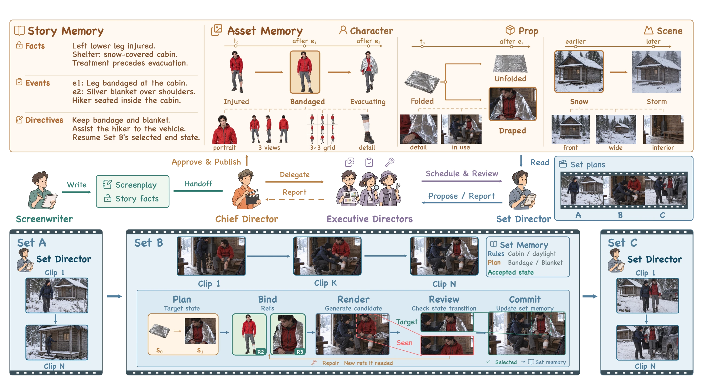
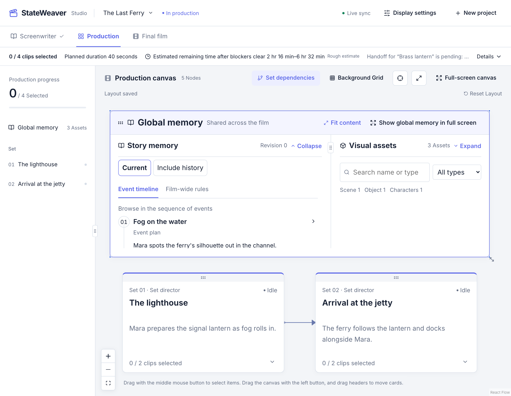

<div align="center">

<h1>StateWeaver: Multi-Agent Coordination of Story-State Transitions for Long-Horizon Video Generation</h1>

[**Modi Jin**](https://ghost233lism.github.io/)<sup>1</sup> · [**Xuying Zhang**](https://zhangxuying1004.github.io/)<sup>2,1</sup> · [**Yijing Guo**](https://scholar.google.com/citations?user=EuOmru0AAAAJ)<sup>3</sup> · [**Haoran Li**](https://jahnsonblack.github.io/)<sup>2</sup> · [**Yanwen Ma**](https://gelercat.com/)<sup>4</sup> · [**Jing Wang**](https://openreview.net/profile?id=~Jing_Wang145)<sup>1</sup> · [**Chenyu Ge**](https://openreview.net/profile?id=~Chenyu_Ge1)<sup>1</sup> · [**Ming-Ming Cheng**](https://mmcheng.net/cmm/)<sup>1</sup> · [**Haoyang Huang**](https://hhyhhyhy.github.io/)<sup>2</sup>

<sup>1</sup> Nankai University · <sup>2</sup> Joy Future Academy, JD · <sup>3</sup> ShanghaiTech University · <sup>4</sup> Beihang University

**English** | [简体中文](README_ZH.md)

<a href="https://arxiv.org/abs/2611.34290"></a>
<a href="https://ghost233lism.github.io/StateWeaver-page/"></a>

<a href="https://ghost233lism.github.io/StateWeaver-page/"></a>

</div>

**StateWeaver** is a multi-agent video production studio for stories that span multiple scenes and clips. As the story progresses, later shots inherit verified character, prop, and scene states. In Studio, you can confirm a screenplay with the screenwriter, inspect each clip's references and review records, and export the assembled film.

## Method

1. **Active States.** The team records what changed and when it takes effect in the story. When a review identifies a mismatch, the team can update references for the affected attributes and generate a new take. Verified results are linked to story time, asset states, and reference versions so later clips can reuse them.
2. **Hierarchical Collaboration.** The chief director assigns connected story units to Sets. Set directors plan, generate, and review Clips. Executive directors handle delegated work such as preparing assets and diagnosing repairs. Each task, Clip, and repair round has its own execution context. Layered memory shares verified facts across Sets.

[](https://ghost233lism.github.io/StateWeaver-page/#research)

## Installation

### 1. Check prerequisites

Use Linux or macOS. The setup below uses Python 3.12, uv, a recent Node.js LTS release (Node 24.12 or later in the 24.x series is recommended), pnpm 10.15.1, and FFmpeg with H.264 (`libx264`) and AAC support. Verify that `ffmpeg` and `ffprobe` are available in your terminal.

```sh
uv --version
node --version
pnpm --version
ffmpeg -version
ffprobe -version
```

If Python 3.12 is missing, run `uv python install 3.12`. If pnpm is missing or a different version is active, install the pinned version with `npm install --global pnpm@10.15.1`. [Install uv](https://docs.astral.sh/uv/getting-started/installation/) · [Download Node.js](https://nodejs.org/en/download) · [Install FFmpeg](https://ffmpeg.org/download.html)

### 2. Get the source and install dependencies

Clone the repository and open its source directory. If you have a source archive, extract it and run the installation commands from the extracted directory.

```sh
git clone https://github.com/ghost233lism/StateWeaver.git
cd StateWeaver
```

```sh
uv sync --locked --no-dev --python 3.12
pnpm install --frozen-lockfile --prod=false
uv run --locked --no-dev stateweaver-db check
```

## Quick start

### 1. Configure providers and the workspace

Create your local configuration from the two templates in the release directory.

```sh
test -e .env || cp .env.example .env
test -e provider-registry.local.json || cp provider-registry.example.json provider-registry.local.json
```

In `provider-registry.local.json`, enable one service for each kind shown below. Replace the placeholder `base_url` and `models` with the provider's API base address and exact model IDs.

| Service | Template protocol | Configuration |
| --- | --- | --- |
| Text and review | `native-responses-v1` | Use a Responses-compatible base URL, such as `https://text.example.invalid/v1`. The first model is the default for both writing and directing. |
| Image | `images-json-v1` | Use the base URL for image generation and editing, and list one model. |
| Video | `h3-ref2va-v1` | Use the base URL that serves H3 `/health` and `/v1/models`. List one Ref2VA model and set `capacity` to the maximum number of video jobs the deployment can process concurrently. |

Set the environment variables named by `credential_ref` in `.env` or in the API process environment. The template uses `STATEWEAVER_TEXT_API_KEY`, `STATEWEAVER_IMAGE_API_KEY`, and `STATEWEAVER_VIDEO_API_KEY`. Set the video key if the service requires authentication. Keep actual credentials in local configuration.

### 2. Configure video generation

#### Default mode · Deploy H3 Ref2VA

On the GPU host, prepare a compatible H3 Ref2VA runtime, its CUDA Python environment, and model weights. The StateWeaver archive provides the [H3 launcher](scripts/deploy_h3.sh). Obtain the runtime and weights separately. For full H3 continuity and editing, use a runtime that advertises `endpoint-anchor-v1`, 73-frame tails, and `endpoint-only-v1`.

```sh
bash scripts/deploy_h3.sh \
  --runtime-dir /path/to/h3-runtime \
  --python /path/to/h3-env/bin/python \
  --model-dir /path/to/h3-weights \
  --output-dir /path/to/shared-media/h3-output \
  --topology dp --gpus 8 --host 127.0.0.1 --port 8653
```

With `dp`, eight independent workers provide up to eight slots. Use `--topology cp --gpus 8` for one worker that spans eight GPUs and set `capacity` to `1`. Set `CUDA_VISIBLE_DEVICES` if you need to choose which GPUs to expose. Run the launcher with `--help` for its arguments.

Set the registry video entry's `base_url` to `http://127.0.0.1:8653` when running on the same host. For a separate GPU host, listen on a private network interface and use its reachable address. Set `capabilities.shared_media_root` to the common directory, such as `/path/to/shared-media`. Both hosts must be able to access the Studio CAS and H3 reference files at the same absolute paths. Set `models` to the ID passed via `--model-name`. The default is [`MiniMax-H3-Sol`](https://github.com/NVlabs/Sana/tree/sol-engine/models/minimax_h3).

#### Custom mode · Connect another video API

Replace the single video entry in `provider-registry.local.json` with a `video-http-v1` entry. The example below maps a JSON submission, an ID-based status query, and an MP4 download. Use your provider's actual paths, field names, states and model. Choose an API or bridge that can deliver an MP4 at least as long as the requested Clip.

```json
{
  "id": "stateweaver-video",
  "label": "Custom video service",
  "kind": "video",
  "protocol": "video-http-v1",
  "base_url": "https://video.example.invalid/v1",
  "credential_ref": "STATEWEAVER_CUSTOM_VIDEO_API_KEY",
  "models": ["your-video-model"],
  "capacity": 2,
  "capabilities": {
    "video_http": {
      "submit_path": "/generations",
      "status_path": "/generations/{id}",
      "content_path": "/generations/{id}/file",
      "submit_id_field": "data.id",
      "status_id_field": "data.id",
      "state_field": "data.phase",
      "states": {
        "waiting": "queued",
        "processing": "running",
        "ready": "succeeded",
        "rejected": "failed",
        "cancelled": "cancelled"
      },
      "request_body": {
        "model": "{{model}}",
        "input": {
          "text": "{{prompt}}",
          "seconds": "{{duration_seconds}}",
          "images": "{{images}}",
          "audio": "{{audio}}"
        }
      },
      "auth_required": true
    }
  }
}
```

- Paths are relative to `base_url`. Keep any version prefix such as `/v1` in the base URL. StateWeaver sends `POST` to `submit_path`, then `GET` to `status_path` and `content_path` with the original task ID. Configure `output_url_field` in place of `content_path` when the completed status returns a file URL. For an external CDN, list its exact HTTPS host in `download_hosts`. StateWeaver sends no API credential to CDN hosts and follows no redirects in this mode.
- Request fields can be nested. A complete placeholder keeps its JSON type. Supported values are `{{prompt}}`, `{{model}}`, `{{duration_seconds}}`, `{{aspect_ratio}}`, `{{short_edge}}`, `{{seed}}`, `{{job_key}}`, `{{images}}`, `{{videos}}`, and `{{audio}}`. Media placeholders become arrays of standard Base64 strings. Images start with the actual predecessor end frame when one exists. The combined raw reference size limit is 64 MiB.
- For text-only providers, set `reference_policy` to `text-only` and remove all media placeholders. Studio retains local references and reviews, and sends a text-only prompt. Reference mode requires `{{images}}`. If the plan includes an audio reference, map `{{audio}}`. Set `edit_submit_path` and map `{{videos}}` if the API can edit the reviewed source video. H3 latent anchoring is available only in H3 mode.
- Set `capacity` to the external API's concurrency limit. An optional `health_path` checks HTTP availability. Authentication defaults to `Authorization: Bearer`. For a raw key header, use `"auth_header": "X-API-Key", "auth_prefix": ""`. Set `STATEWEAVER_CUSTOM_VIDEO_API_KEY` or your chosen credential reference in the environment.
- For synchronous, multipart, WebSocket, or SDK-only providers, run a bridge that exposes the example's submit, status and content contract. The bridge should return a stable, non-secret task ID, persist its mapping to the upstream request, and serve the same verified MP4 by that ID after a restart. Keep upstream URL signing and authentication inside the bridge.

Restart the API after changing the registry and create a new project. Existing projects retain their original provider binding. Previously accepted jobs are collected by their original route and ID. Keep the original credential reference available while they finish. An uncertain submission requires reconciliation before any retry.

### 3. Start the API

In the first terminal, replace `--data-root` with your workspace path and leave the API running. H3 mode requires a shared workspace. Custom mode also accepts a local directory.

```sh
uv run --locked --no-dev --env-file .env stateweaver \
  --data-root /path/to/shared-media/workspace \
  --registry provider-registry.local.json
```

### 4. Build and open Studio

In a second terminal, return to the `StateWeaver` source directory. The first command checks the frontend API types and builds the files in `apps/web/dist`. Leave the second command running while you use Studio.

```sh
UV_LOCKED=1 UV_NO_DEV=1 pnpm --dir apps/web build
node scripts/serve_studio.mjs --host 127.0.0.1 --port 5276 \
  --api-target http://127.0.0.1:8186
```

[](assets/readme/studio-en.webp)

### 5. Verify the installation

With both services running, check that Studio serves its homepage and can reach the API through the frontend proxy.

```sh
curl -fsS --max-time 5 http://127.0.0.1:5276/ -o /dev/null
curl -fsS --max-time 5 http://127.0.0.1:5276/api/v1/health
```

## Using Studio

Open **Display settings** in the upper right and choose **简体中文** or **English** at any time. The interface updates immediately. New stories use the selected language for screenwriting, directing plans, media descriptions, and reviews. Each story keeps the production language set when it was created. Explicitly specified dialogue and on-screen text keep their original language.

1. **Script.** Create a project, develop the screenplay with the screenwriter, and confirm it. Choose whether the chief director coordinates production directly or delegates specialized tasks.
2. **Production.** Follow Set dependencies, shared memory, asset states, and Clip progress. Inspect references and reviews, compare takes, and preview the selected sequence for a Set. Pausing stops new role work. Already accepted jobs can still finish and be collected.
3. **Final film.** Play or download the assembled film with its audio track, when available, and open its export record to see the sources used in the cut.

## Citation

```bibtex
@misc{jin2026stateweaver,
  title = {{StateWeaver}: Multi-Agent Coordination of Story-State Transitions for Long-Horizon Video Generation},
  author = {Jin, Modi and Zhang, Xuying and Guo, Yijing and Li, Haoran and Ma, Yanwen and Wang, Jing and Ge, Chenyu and Cheng, Ming-Ming and Huang, Haoyang},
  year = {2026},
  eprint = {2611.34290},
  archivePrefix = {arXiv},
  url = {https://arxiv.org/abs/2611.34290}
}
```

## License

The original StateWeaver code and materials are licensed under Creative Commons Attribution-NonCommercial 4.0 International. Third-party components are governed by their respective licenses. [License text](LICENSE) · [CC BY-NC 4.0](https://creativecommons.org/licenses/by-nc/4.0/)
