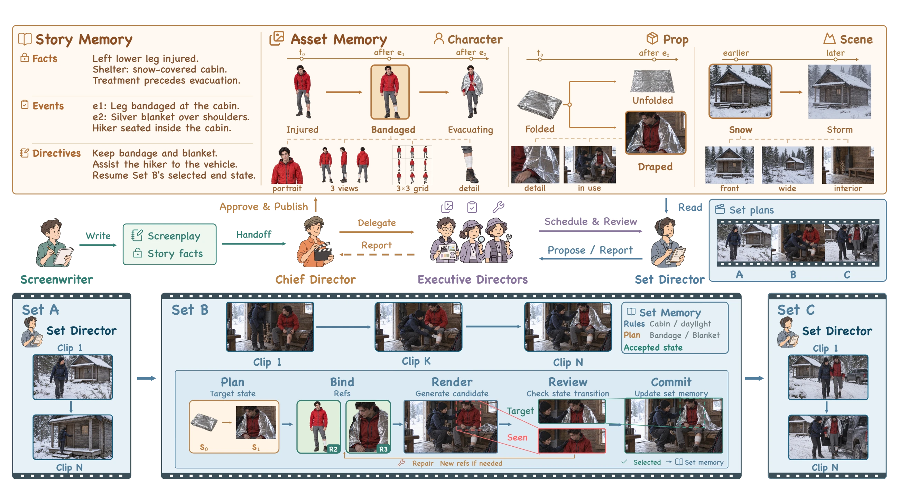
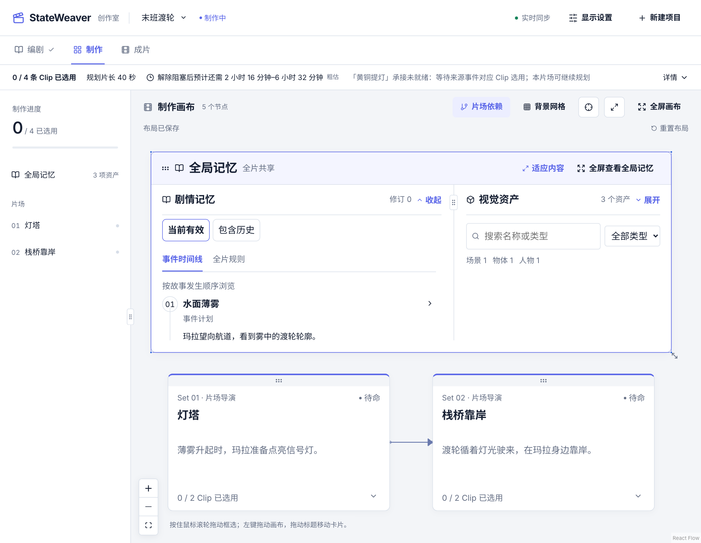

<div align="center">

<h1>StateWeaver: Multi-Agent Coordination of Story-State Transitions for Long-Horizon Video Generation</h1>

[**Modi Jin**](https://ghost233lism.github.io/)<sup>1</sup> · [**Xuying Zhang**](https://zhangxuying1004.github.io/)<sup>2,1</sup> · [**Yijing Guo**](https://scholar.google.com/citations?user=EuOmru0AAAAJ)<sup>3</sup> · [**Haoran Li**](https://jahnsonblack.github.io/)<sup>2</sup> · [**Yanwen Ma**](https://gelercat.com/)<sup>4</sup> · [**Jing Wang**](https://openreview.net/profile?id=~Jing_Wang145)<sup>1</sup> · [**Chenyu Ge**](https://openreview.net/profile?id=~Chenyu_Ge1)<sup>1</sup> · [**Ming-Ming Cheng**](https://mmcheng.net/cmm/)<sup>1</sup> · [**Haoyang Huang**](https://hhyhhyhy.github.io/)<sup>2</sup>

<sup>1</sup> 南开大学 · <sup>2</sup> 京东探索研究院 · <sup>3</sup> 上海科技大学 · <sup>4</sup> 北京航空航天大学

[English](README.md) | **简体中文**

<a href="https://arxiv.org/abs/2611.34290"></a>
<a href="https://ghost233lism.github.io/StateWeaver-page/"></a>

<a href="https://ghost233lism.github.io/StateWeaver-page/"></a>

</div>

**StateWeaver** 是一个支持多个场景和片段的多智能体视频制作工作室。随着剧情推进，后续镜头会继承已经核验的人物、道具和场景状态。你可以在 Studio 中与编剧确认剧本，查看各片段的参考素材和审核记录，并导出合成后的影片。


## 方法

1. **主动状态（Active States）**。制作团队记录发生了什么变化，以及变化在故事中的生效时间。审核发现偏差时，团队可以针对受影响的属性更新参考素材并重新生成。核验通过的结果关联故事时间、资产状态和参考版本，供后续片段复用。
2. **层级化协作（Hierarchical Collaboration）**。总导演把相互关联的剧情单元分配到各个片场（Set），片场导演规划、生成和审核片段（Clip），执行导演处理受委派的素材准备、返修诊断等工作。每项任务、每个片段和每轮返修拥有独立的执行上下文。片场间通过分层记忆共享已核验事实。

[](https://ghost233lism.github.io/StateWeaver-page/#research)

## 安装

### 1. 检查环境

使用 Linux 或 macOS。以下流程使用 Python 3.12、uv、较新的 Node.js LTS（推荐 24.12 或更新的 24.x 版本）、pnpm 10.15.1，以及支持 H.264（`libx264`）和 AAC 的 FFmpeg。确认 `ffmpeg` 和 `ffprobe` 都可以在终端调用。

```sh
uv --version
node --version
pnpm --version
ffmpeg -version
ffprobe -version
```

缺少 Python 3.12 时，运行 `uv python install 3.12`。未安装 pnpm 或当前版本不同，可以运行 `npm install --global pnpm@10.15.1` 安装指定版本。[安装 uv](https://docs.astral.sh/uv/getting-started/installation/) · [下载 Node.js](https://nodejs.org/en/download) · [安装 FFmpeg](https://ffmpeg.org/download.html)

### 2. 获取源码并安装依赖

克隆仓库并进入源码目录。如果已有源码包，解压后在解压目录运行安装命令。

```sh
git clone https://github.com/ghost233lism/StateWeaver.git
cd StateWeaver
```

```sh
uv sync --locked --no-dev --python 3.12
pnpm install --frozen-lockfile --prod=false
uv run --locked --no-dev stateweaver-db check
```

## 快速开始

### 1. 配置上游服务和工作区

用同级目录中的两个模板创建本地配置。

```sh
test -e .env || cp .env.example .env
test -e provider-registry.local.json || cp provider-registry.example.json provider-registry.local.json
```

在 `provider-registry.local.json` 中为下表每一类启用一个服务，将占位的 `base_url` 和 `models` 改为实际 API 基地址和准确的模型 ID。

| 服务 | 模板协议 | 配置说明 |
| --- | --- | --- |
| 文本与审核 | `native-responses-v1` | 使用兼容 Responses 的基地址，例如 `https://text.example.invalid/v1`。编剧和导演默认使用列表中的第一个模型。 |
| 图片 | `images-json-v1` | 使用图片生成和编辑服务的基地址，只填写一个模型。 |
| 视频 | `h3-ref2va-v1` | 填写能访问 H3 的 `/health` 和 `/v1/models` 的基地址，只填写一个 Ref2VA 模型。`capacity` 填该部署能同时处理的视频作业数。 |

在 `.env` 或 API 进程环境中设置 `credential_ref` 指定的变量。模板默认使用 `STATEWEAVER_TEXT_API_KEY`、`STATEWEAVER_IMAGE_API_KEY` 和 `STATEWEAVER_VIDEO_API_KEY`。视频服务要求鉴权时填写视频凭证。实际凭证保存在本地配置中。

### 2. 配置视频生成

#### 默认模式 · 部署 H3 Ref2VA

在 GPU 主机上准备兼容的 H3 Ref2VA 运行时、CUDA Python 环境和模型权重。StateWeaver 源码包提供 [H3 启动脚本](scripts/deploy_h3.sh)，运行时和权重需要单独获取。要使用完整的 H3 接续和编辑功能，运行时需公布 `endpoint-anchor-v1`、73 帧尾段和 `endpoint-only-v1`。

```sh
bash scripts/deploy_h3.sh \
  --runtime-dir /path/to/h3-runtime \
  --python /path/to/h3-env/bin/python \
  --model-dir /path/to/h3-weights \
  --output-dir /path/to/shared-media/h3-output \
  --topology dp --gpus 8 --host 127.0.0.1 --port 8653
```

`dp` 模式下，八张 GPU 独立处理任务，最多提供八个并发槽位。用 `--topology cp --gpus 8` 可让八张卡共同处理一个任务，此时 `capacity` 填 `1`。如需选择 GPU，设置 `CUDA_VISIBLE_DEVICES`。运行脚本并加上 `--help` 可查看参数。

同机部署时，视频条目的 `base_url` 填 `http://127.0.0.1:8653`。GPU 主机独立部署时，在私网接口监听，并填 Studio 可访问的地址。`capabilities.shared_media_root` 填共享根目录，例如 `/path/to/shared-media`。两端要能通过相同的绝对路径访问 Studio 的 CAS 和 H3 参考素材。`models` 填 `--model-name` 指定的 ID，默认为 [`MiniMax-H3-Sol`](https://github.com/NVlabs/Sana/tree/sol-engine/models/minimax_h3)。

#### 通用模式 · 接入其他视频 API

将 `provider-registry.local.json` 中唯一的视频服务条目替换为 `video-http-v1`。下例配置 JSON 提交、按任务 ID 查询和 MP4 下载。按实际服务修改接口路径、字段、状态值和模型。API 或桥接服务返回的 MP4 时长需覆盖本次 Clip 的请求时长。

```json
{
  "id": "stateweaver-video",
  "label": "Custom video service",
  "kind": "video",
  "protocol": "video-http-v1",
  "base_url": "https://video.example.invalid/v1",
  "credential_ref": "STATEWEAVER_CUSTOM_VIDEO_API_KEY",
  "models": ["your-video-model"],
  "capacity": 2,
  "capabilities": {
    "video_http": {
      "submit_path": "/generations",
      "status_path": "/generations/{id}",
      "content_path": "/generations/{id}/file",
      "submit_id_field": "data.id",
      "status_id_field": "data.id",
      "state_field": "data.phase",
      "states": {
        "waiting": "queued",
        "processing": "running",
        "ready": "succeeded",
        "rejected": "failed",
        "cancelled": "cancelled"
      },
      "request_body": {
        "model": "{{model}}",
        "input": {
          "text": "{{prompt}}",
          "seconds": "{{duration_seconds}}",
          "images": "{{images}}",
          "audio": "{{audio}}"
        }
      },
      "auth_required": true
    }
  }
}
```

- 路径相对于 `base_url`，保留其中的版本前缀，例如 `/v1`。StateWeaver 用 `POST` 调用 `submit_path`，用原任务 ID 对 `status_path` 和 `content_path` 发起 `GET`。如果完成状态返回文件 URL，用 `output_url_field` 替代 `content_path`。外部 CDN 的 HTTPS 主机需明确列在 `download_hosts`，此模式不会向 CDN 发送 API 凭证，也不会跟随重定向。
- 请求字段支持嵌套，完整占位符会保留 JSON 值类型。可用字段为 `{{prompt}}`、`{{model}}`、`{{duration_seconds}}`、`{{aspect_ratio}}`、`{{short_edge}}`、`{{seed}}`、`{{job_key}}`、`{{images}}`、`{{videos}}` 和 `{{audio}}`。媒体占位符展开为标准 Base64 字符串数组。若有可用的前段真实末帧，图片列表将其置于首位。参考文件原始大小合计上限为 64 MiB。
- 仅支持文生视频的服务可将 `reference_policy` 设为 `text-only`，并移除所有媒体占位符。Studio 保留本地参考和审核，向服务发送纯文字提示词。参考模式需要 `{{images}}`。计划含音频参考时需映射 `{{audio}}`。如果服务支持编辑已审核的源视频，配置 `edit_submit_path` 并映射 `{{videos}}`。H3 的 latent 锚定仅在默认模式可用。
- `capacity` 填外部 API 的并发上限。可选的 `health_path` 用于检查 HTTP 可达性。默认鉴权格式为 `Authorization: Bearer`，例如可用 `"auth_header": "X-API-Key", "auth_prefix": ""` 切换到直接传密钥的请求头。在环境中设置 `STATEWEAVER_CUSTOM_VIDEO_API_KEY` 或你指定的凭证变量。
- 同步接口、multipart、WebSocket 或仅提供 SDK 的服务，可通过自备桥接服务接入。桥接服务按上例暴露提交、查询和取片接口，返回稳定且不包含凭证的任务 ID，持久化上游请求对应关系，并在重启后继续按原 ID 提供同一份经过验证的 MP4。上游签名和鉴权在桥接服务内处理。

改完配置后重启 API 并创建新项目。已有项目保留原服务绑定，已受理的任务按原路由和 ID 收取，收取完成前保留原凭证变量。提交结果不明时先对账再决定是否重试。

### 3. 启动 API

在第一个终端，把 `--data-root` 换成实际工作区路径，然后保持 API 运行。H3 模式要求共享工作区，通用模式也可使用本地目录。

```sh
uv run --locked --no-dev --env-file .env stateweaver \
  --data-root /path/to/shared-media/workspace \
  --registry provider-registry.local.json
```

### 4. 构建并打开 Studio

在第二个终端进入 `StateWeaver` 源码目录。第一条命令会核对前端 API 类型，并将静态文件构建到 `apps/web/dist`。使用 Studio 时保持第二条命令运行。

```sh
UV_LOCKED=1 UV_NO_DEV=1 pnpm --dir apps/web build
node scripts/serve_studio.mjs --host 127.0.0.1 --port 5276 \
  --api-target http://127.0.0.1:8186
```

[](assets/readme/studio-zh.webp)

### 5. 检查首次启动

两端启动后，检查 Studio 首页能否加载，以及前端代理能否访问 API。

```sh
curl -fsS --max-time 5 http://127.0.0.1:5276/ -o /dev/null
curl -fsS --max-time 5 http://127.0.0.1:5276/api/v1/health
```

## 使用 Studio

打开右上角的**显示设置**，可随时选择**简体中文**或 **English**，界面即时切换。接下来新建的故事使用所选语言编写剧本、导演计划、素材描述和审核报告。每个故事沿用创建时确定的制作语言。明确指定的台词或画面文字保留原语言。

1. **编剧。** 新建项目，与编剧讨论并确认剧本。确认时，选择由总导演直接统筹或委派专项任务。
2. **制作。** 查看片场依赖、共享记忆、资产状态和 Clip 进度。可追查参考素材和审核记录、比较候选片段，并预览片场已选片段的连播。暂停会停止新的角色工作，已受理作业仍可完成并按原任务收取。
3. **成片。** 播放或下载合成影片，有音轨时随影片交付。展开成片来源记录可查看实际使用的素材。

## 引用

```bibtex
@misc{jin2026stateweaver,
  title = {{StateWeaver}: Multi-Agent Coordination of Story-State Transitions for Long-Horizon Video Generation},
  author = {Jin, Modi and Zhang, Xuying and Guo, Yijing and Li, Haoran and Ma, Yanwen and Wang, Jing and Ge, Chenyu and Cheng, Ming-Ming and Huang, Haoyang},
  year = {2026},
  eprint = {2611.34290},
  archivePrefix = {arXiv},
  url = {https://arxiv.org/abs/2611.34290}
}
```

## 许可协议

StateWeaver 的原创代码和材料采用知识共享署名-非商业性使用 4.0 国际许可。第三方组件适用各自的许可证。[许可全文](LICENSE) · [CC BY-NC 4.0](https://creativecommons.org/licenses/by-nc/4.0/)
